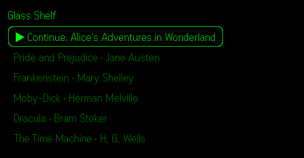
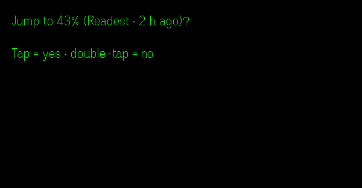

# Glass Shelf

Read your self-hosted [Calibre-Web](https://github.com/janeczku/calibre-web) library on [Even Realities G2](https://www.evenrealities.com/) glasses, with your reading position synced to KOReader-compatible apps such as [Readest](https://readest.com) and [KOReader](https://koreader.rocks).

- Browse your recently added books on the glasses, or search from your phone and send a book to the glasses.
- Read EPUBs a page at a time: pages are measured with the G2 font, so they fill the display without clipping.
- Pick up where you left off on another device. Positions sync through [Calibre-Web-Automated](https://github.com/crocodilestick/Calibre-Web-Automated)'s KOReader sync server, down to the exact character.

| Library | Reading | Picking up from another device |
|---|---|---|
|  |  |  |

<sub>Screenshots from the Even Hub simulator, with public-domain books.</sub>

**Status:** early development, working end to end on real G2 hardware with Calibre-Web-Automated and Readest. See [SPEC.md](SPEC.md) for the design and roadmap. Not affiliated with Even Realities.

## Contents

- [Requirements](#requirements)
- [Server setup](#server-setup)
- [Reading apps on your other devices](#reading-apps-on-your-other-devices)
- [Run it on your glasses](#run-it-on-your-glasses)
- [Using Glass Shelf](#using-glass-shelf)
- [How syncing behaves](#how-syncing-behaves)
- [Limitations](#limitations)
- [Privacy](#privacy)
- [Development](#development)

## Requirements

- Even Realities G2 glasses and the Even app **2.2.10 or newer** on your phone.
- **Calibre-Web-Automated (CWA)** for reading *and* syncing. Plain Calibre-Web works for browsing and reading, but has no sync server.
- An **address for your server that your phone can reach**: HTTPS on the internet, or plain HTTP on a private network (a VPN such as WireGuard or Tailscale, or your home Wi-Fi). See [Public or private network](#public-or-private-network).
- A **reverse proxy** in front of it that you can add headers to (nginx, nginx proxy manager, Caddy, ...). This is needed even on a private network: the app runs in a web view on your phone, which enforces CORS, and Calibre-Web never sends CORS headers itself.
- Node.js 20+ to build the app.

## Server setup

### 1. Turn on KOReader sync in CWA

In CWA, open **Admin → CWA Settings** and tick **Enable KOReader Sync (CWA Plugin)**. It is off by default. While it is off, sync requests get `503 KOReader sync is disabled` and the glasses read without syncing.

Glass Shelf logs in to both the book feed and the sync server with your normal Calibre-Web username and password (HTTP Basic). This also works when Calibre-Web authenticates through LDAP, OAuth or an identity proxy such as Authentik; KOReader's own md5-key login does not, because the server has no local password to compare it with.

### 2. Allow the app through CORS

#### Public or private network

- **Public:** your server already has an HTTPS address on the internet, usually behind nginx, nginx proxy manager or Caddy. Add the CORS rules below to that proxy.
- **Private:** your phone reaches the server over a VPN (WireGuard, Tailscale) or your home Wi-Fi, and nothing is exposed to the internet. You can skip HTTPS and certificates and run a small plain-HTTP proxy that only adds CORS headers: see [Private network: a minimal proxy](#private-network-a-minimal-proxy). The installed app talks to plain `http://` addresses (tested on Android; iOS is untested and may refuse plain HTTP).

#### What the proxy must do

Your reverse proxy must add CORS headers for two paths: `/opds` (the book feed and downloads) and `/kosync` (sync). The rest of the site can stay as it is.

What the proxy needs to do:

- Answer `OPTIONS` preflight requests on those paths with `204`, **without** requiring a login.
- Add these headers to every response on those paths, **including errors** (401, 404, 5xx). Without them on a 401, a wrong password shows up in the app as "could not reach the server".
  - `Access-Control-Allow-Origin: *`
  - `Access-Control-Allow-Headers: Authorization, Accept, Content-Type, x-auth-user, x-auth-key`
  - `Access-Control-Allow-Methods: GET, PUT, OPTIONS`
  - `Access-Control-Max-Age: 86400` (optional; saves a preflight per request)

`*` is safe here because the app sends credentials in the `Authorization` header, not cookies, so other websites cannot use your login. Keep `*`: the installed app loads from a local address on your phone (`http://127.0.0.1:` and a port number), so there is no fixed origin to narrow it to.

**If Calibre-Web trusts a login header,** strip it on these paths. With **Allow Reverse Proxy Authentication** turned on (common with Authentik or Authelia), Calibre-Web logs in whoever a header such as `X-authentik-username` names. Your identity proxy sets that header on the paths it protects, but `/opds` and `/kosync` bypass it, so anyone who can reach them could send the header themselves and log in as any user. The examples below remove it; use the header name from your Calibre-Web settings.

<details>
<summary><b>nginx / nginx proxy manager</b> (example)</summary>

In nginx proxy manager, add this to the proxy host's **Advanced** tab, replacing the `proxy_pass` target with your CWA container. With plain nginx, put it in the `server` block.

```nginx
location ~ ^/(opds|kosync)(/|$) {
    if ($request_method = OPTIONS) {
        add_header Access-Control-Allow-Origin "*";
        add_header Access-Control-Allow-Headers "Authorization, Accept, Content-Type, x-auth-user, x-auth-key";
        add_header Access-Control-Allow-Methods "GET, PUT, OPTIONS";
        add_header Access-Control-Max-Age 86400;
        return 204;
    }
    add_header Access-Control-Allow-Origin "*" always;
    add_header Access-Control-Allow-Headers "Authorization, Accept, Content-Type, x-auth-user, x-auth-key" always;
    add_header Access-Control-Allow-Methods "GET, PUT, OPTIONS" always;

    proxy_pass http://calibre-web-automated:8083;
    proxy_set_header X-authentik-username "";    # your reverse-proxy login header, if any
    proxy_set_header Host $host;
    proxy_set_header X-Forwarded-For $proxy_add_x_forwarded_for;
    proxy_set_header X-Forwarded-Proto $scheme;
}
```

nginx drops `add_header` lines inherited from the `server` block in any `location` that sets its own, so keep the CORS headers in this `location`.

</details>

<details>
<summary><b>Caddy</b> (example)</summary>

```caddy
books.example.com {
    @sync path /opds /opds/* /kosync /kosync/*
    @preflight {
        method OPTIONS
        path /opds /opds/* /kosync /kosync/*
    }
    header @sync {
        Access-Control-Allow-Origin "*"
        Access-Control-Allow-Headers "Authorization, Accept, Content-Type, x-auth-user, x-auth-key"
        Access-Control-Allow-Methods "GET, PUT, OPTIONS"
        Access-Control-Max-Age 86400
    }
    respond @preflight 204
    reverse_proxy calibre-web-automated:8083 {
        header_up -X-authentik-username    # your reverse-proxy login header, if any
    }
}
```

</details>

#### Private network: a minimal proxy

On a VPN or home network, a plain-HTTP Caddy in front of CWA is enough. This one serves only `/opds` and `/kosync` (everything else gets `404`), so it is not a second way into the rest of Calibre-Web:

```caddy
:8084 {
    @app path /opds /opds/* /kosync /kosync/*
    handle @app {
        header {
            Access-Control-Allow-Origin "*"
            Access-Control-Allow-Headers "Authorization, Accept, Content-Type, x-auth-user, x-auth-key"
            Access-Control-Allow-Methods "GET, PUT, OPTIONS"
            Access-Control-Max-Age 86400
        }
        @preflight method OPTIONS
        respond @preflight 204
        reverse_proxy calibre-web-automated:8083 {
            header_up -X-authentik-username    # your reverse-proxy login header, if any
        }
    }
    respond 404
}
```

Then build with `SERVER_ORIGIN=http://<server-ip>:8084`, using the address your phone reaches over the VPN or Wi-Fi.

- Plain HTTP sends your password unencrypted, which is only acceptable on a network you trust. Over WireGuard or Tailscale the tunnel itself is encrypted.
- If you firewall the port, allow the address your phone's traffic actually arrives from. Some VPN gateways replace the phone's VPN address with their own.
- Your phone's VPN must route your server's subnet (WireGuard's `AllowedIPs`). If the app reports it could not reach the server, open the address in the phone's browser: it should ask for a username and password. If the page never loads, the phone has no route to the server.

Check it from any machine (replace the address):

```bash
curl -si -X OPTIONS https://books.example.com/opds \
  -H 'Origin: http://localhost:5173' \
  -H 'Access-Control-Request-Method: GET' \
  -H 'Access-Control-Request-Headers: authorization' | grep -i -e '^HTTP' -e access-control
```

You should see `204` and the four `access-control-*` headers.

### 3. Run CWA in UTC (recommended)

CWA reports sync times in the container's time zone as if it were UTC, so a container on, say, America/New_York reports times hours in the future. Set `TZ=UTC` on the CWA container. Glass Shelf never relies on these times; it just hides a "2 h ago" it cannot trust.

## Reading apps on your other devices

Positions only sync between devices that use **the same Calibre-Web account** and **the same EPUB file**.

**Readest** (iOS, Android, desktop):

- **KOReader Sync:** server `https://books.example.com/kosync`, your Calibre-Web username and password, document matching **Binary**.
- **Books:** add your library as an OPDS catalog at `https://books.example.com/opds/`. Keep the trailing slash; without it Readest may show the catalog without opening it. Download books from there rather than from elsewhere, so the file matches what the glasses read. If browsing still shows nothing, `https://books.example.com/opds/new` lists recent books directly.

**KOReader:** use CWA's own sync plugin (open `https://books.example.com/kosync` in a browser for the download and instructions). It logs in with your normal password, like Glass Shelf. KOReader's built-in Progress sync, pointed at your server with **Binary** document matching, also works, but only for accounts with a password stored in Calibre-Web itself: it logs in with an md5 key, which servers using LDAP, OAuth or an identity proxy cannot check.

Only apps that speak KOReader sync share positions. Calibre-Web's built-in web reader keeps its own bookmarks, which other apps cannot see.

## Run it on your glasses

Each person builds their own copy, because the app's network permission names your server.

```bash
git clone <this repository> glass-shelf
cd glass-shelf
npm install
cp .env.example .env.local    # then set SERVER_ORIGIN=https://books.example.com
```

`SERVER_ORIGIN` is only the scheme, host and optional port: no path, no trailing slash.

### Try it straight from your computer (developer mode)

1. Turn on **Developer Mode** in the Even app: sign in at [hub.evenrealities.com](https://hub.evenrealities.com/login) with the same account you use in the Even app, then force-quit and reopen the Even app. A developer section appears at the top right of the **Even Hub** tab, with a QR scanner.
2. Start the dev server: `npm run dev`
3. Show a QR code for it, using your computer's address on the network your phone can reach: `npx evenhub qr --url http://<your-computer-ip>:5173`
4. Scan it from the Even Hub developer section. The app opens on your glasses and its settings page on your phone.

### Install it as an app (private build)

To keep Glass Shelf on your glasses without a computer running, package it and install it as a private build, visible only to your Even account.

1. In `.env.local`, also set `PACKAGE_ID` to an id of your own, such as `com.yourname.glassshelf`. Package ids are unique across Even Hub, so the default one is taken. Use lowercase letters and digits, separated by dots, with no hyphens.
2. Package it:

   ```bash
   npm run pack    # writes glass-shelf.ehpk
   ```

   This builds the app and writes `build/app.json` with your package id, and with your `SERVER_ORIGIN` as the only allowed network origin.
3. Sign in at [hub.evenrealities.com](https://hub.evenrealities.com/login), create a project, and upload `glass-shelf.ehpk` as a build. Leave it **private**.
4. In the Even app, in the **Even Hub** tab (Developer Mode), go to **Me → Apps → Private builds** and tap **Install**. Glass Shelf then appears in the glasses menu.
5. Open Glass Shelf. Your server settings carry over from developer mode.

Your server address is part of the uploaded build, as its network permission; your username and password are not. To update, pack and upload a new build, then install it again. Even's guide: [Private Testing](https://hub.evenrealities.com/docs/test/private-testing).

The `.ehpk` that CI builds uses a placeholder origin and only proves the build works.

## Using Glass Shelf

**On your phone**, the Glass Shelf page (shown in the Even app while Glass Shelf runs) has:

- **Server:** your Calibre-Web address, username and password. **Save and test** checks the book feed and the sync login. Sync problems only warn: reading works without sync.
- **Search:** search your whole library and **Send to glasses**.
- The app's own origin, for troubleshooting.

**On your glasses:**

| Gesture | Library | Reading | "Jump to …?" prompt |
|---|---|---|---|
| Swipe | Move through the list | Next / previous page | |
| Tap | Open the book | Show or hide the footer | Jump to the other device's position |
| Double-tap | Exit (asks first) | Save, sync and go back to the library | Stay where you are |

The library lists **▶ Continue: \<your last book\>**, then the 19 most recently added books. The reading footer shows progress through the book, the chapter, the percentage and the time.

## How syncing behaves

- **When a book opens,** the glasses ask the server for its latest position. If another device is further on, they offer to jump there, naming the device. If the server does not answer within 4 seconds, the book opens at your last position on the glasses.
- **While you read,** your position is sent 10 seconds after you stop turning pages, and straight away when you double-tap back to the library. Positions that fail to send (no signal) are kept and sent later.
- **Neither app checks again while a book stays open,** and the phone does not tell the glasses when you switch apps. Before switching devices, double-tap out of the book on the glasses, or close it in the other app.
- **Each device shows whole pages.** Positions are exact to the character, but a phone page holds two or three glasses pages, so the line you were on can be anywhere on the page the phone opens. Going the other way, the glasses show the page that contains the other device's position.

## Limitations

- EPUB only (no PDF, CBZ, kepub). DRM-protected books cannot be opened.
- Text only: images, tables and styling are not shown.
- The glasses list the 20 most recent books; use search on the phone for the rest.
- One server and one account at a time.
- A book's table of contents and cover pages are skipped while reading.
- In the installed app, books download again after the Even app restarts (see [Privacy](#privacy)).

## Privacy

- Your server address, username and credentials are stored only in the Even app's storage on your phone. That storage is not private to Glass Shelf: a second app installed from the same developer account read Glass Shelf's saved settings, and Even does not document whether apps from other developers can too. Use an account that only reads books, as Glass Shelf needs, rather than an admin account. The password is kept as the HTTP Basic credential and KOReader's md5 key, both derived from it; treat them like the password.
- The app talks only to your server. Nothing is sent anywhere else.
- Downloaded books are cached on the phone (the last three). In the installed app the cache only lasts until the Even app restarts, so a book downloads again after that.

## Development

```bash
npm run dev          # Vite dev server on :5173
npm run simulate     # Even Hub simulator pointed at the dev server
npm test             # unit tests
npm run test:live    # checks against a real server (see below)
npm run pack         # build and package
```

- **Dev settings:** put `VITE_DEV_SERVER_URL`, `VITE_DEV_SERVER_USER` and `VITE_DEV_SERVER_PASSWORD` in `.env.local` to pre-fill the app's settings in dev builds (handy in the simulator). Never used in packaged builds.
- **Live tests** use the same variables: they read the book feed, download and paginate every recent book, round-trip sync positions and check the sync login. A dedicated read-only account is a good idea.
- **Device log:** in dev builds, the app on your phone sends its events, glasses commands and errors to the dev server, which appends them to `build/device.log`.
- [SPEC.md](SPEC.md) records the design, protocol details and what was learned along the way.

## Acknowledgements

Built with Even Realities' [Even Hub SDK](https://www.npmjs.com/package/@evenrealities/even_hub_sdk) and [pretext](https://www.npmjs.com/package/@evenrealities/pretext) font measurement, [JSZip](https://stuk.github.io/jszip/) and [SparkMD5](https://github.com/satazor/js-spark-md5). The community [even-g2-notes](https://github.com/nickustinov/even-g2-notes) were invaluable.

## License

MIT. See [LICENSE](LICENSE).
